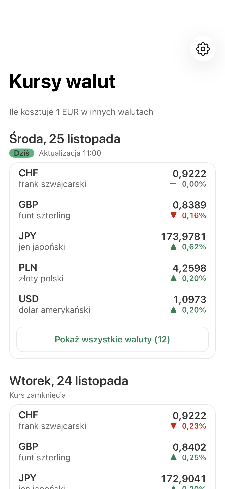
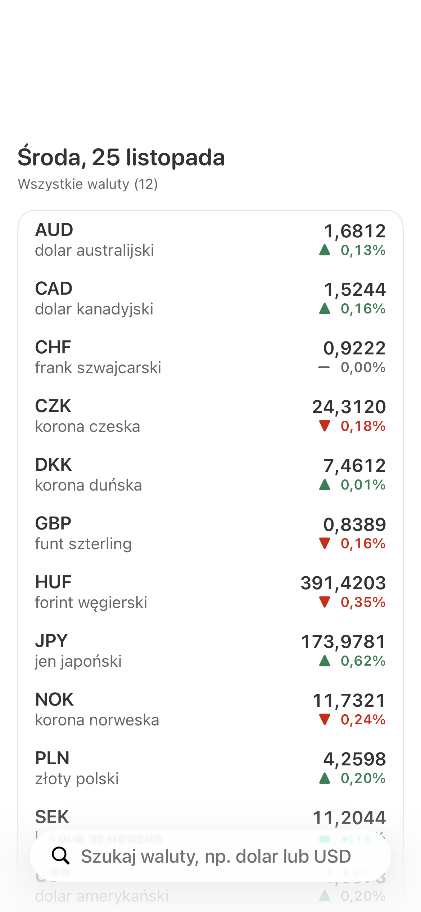
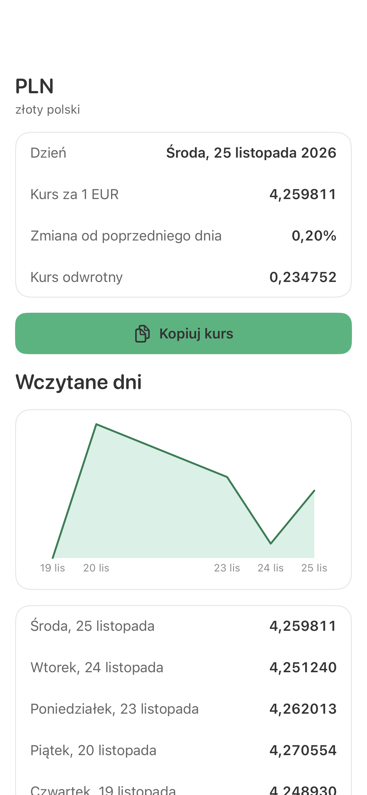
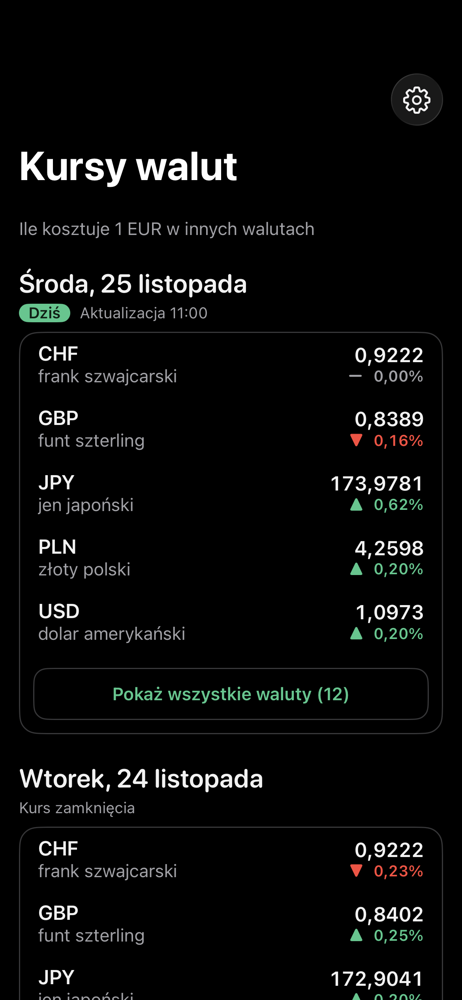
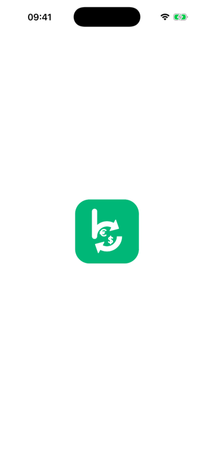
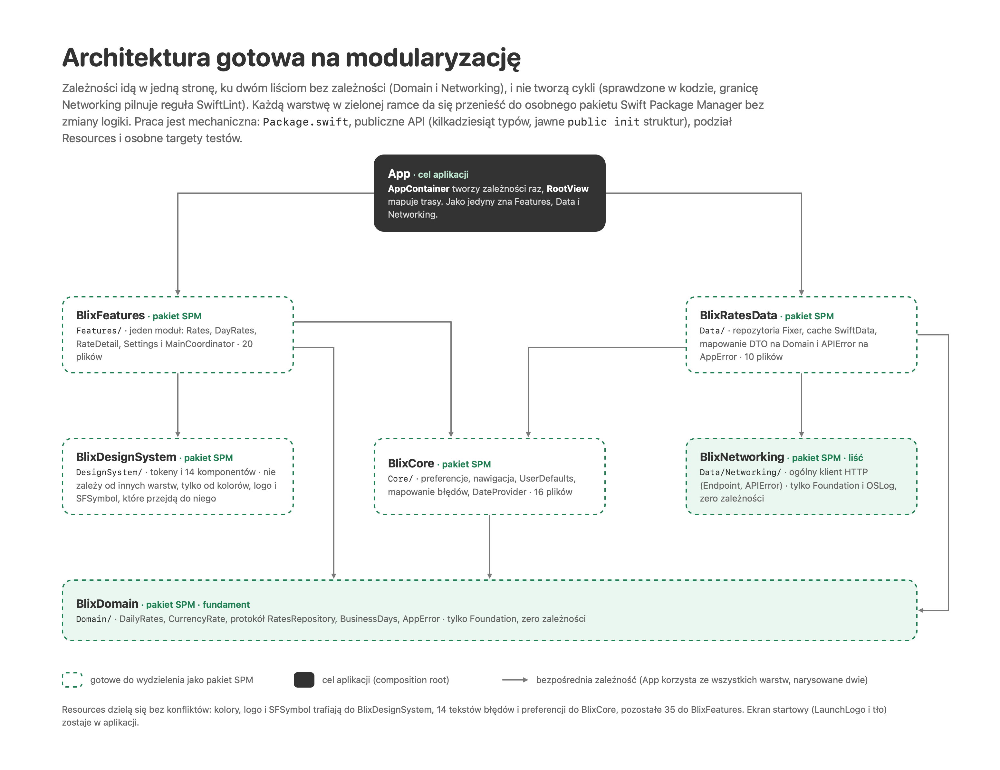

# Blix Waluty

Aplikacja na iPhone'a, która pokazuje kursy walut względem euro z [fixer.io](https://fixer.io), dzień po dniu,
od najnowszego. Zadanie rekrutacyjne dla Blix.

<p>
  
  
  
  
</p>

## Makiety i design system

- **[Makiety ekranów](https://claude.ai/artifact/4zja4gUkWxrhMDHNBggjtf)**: wszystkie ekrany i stany aplikacji
  (lista, wszystkie waluty z wyszukiwaniem, szczegóły, ustawienia, błędy, brak klucza, widoki poziome, splash).
  Część plansz jest klikalna.
- **[Design system](https://claude.ai/artifact/ASKLoCaCzER5fN3xBWppeU)**: kolory, typografia, odstępy i 14 komponentów
  dokładnie tak, jak są w kodzie (`BlixRekrtuacja/DesignSystem`), oraz opis danych i ograniczeń API.

Splash przy pierwszym wczytaniu: zaczyna się dokładnie jak ekran startowy, potem logo się unosi, pojawia się nazwa,
a strzałki kręcą się, dopóki nie przyjdą kursy (nagranie z symulatora).



## Co potrafi

- Kursy pogrupowane po dniach, od dziś wstecz. Każdy dzień pokazuje pięć popularnych walut
  i zmianę względem poprzedniego dnia (strzałka i kolor).
- Starsze dni doczytują się same podczas przewijania.
- „Pokaż wszystkie waluty” otwiera cały dzień (ok. 170 walut) z wyszukiwaniem po kodzie i nazwie.
- Szczegóły kursu: dzień, dokładna wartość (6 miejsc po przecinku), zmiana, kurs odwrotny i kopiowanie.
  Od trzech wczytanych dni dochodzi wykres i lista wczytanych dni.
- Polski i angielski (przełączane w aplikacji), tryb jasny i ciemny, pion i poziom,
  Dynamic Type od xSmall do AX5.
- Wczytane dni są zapisane na urządzeniu (SwiftData), więc powrót do nich nie kosztuje zapytań.
- Błędy są pokazywane w miejscu danych, bez alertów: pusty ekran z przyciskiem „Spróbuj ponownie” albo karta
  na końcu listy, gdy nie udało się wczytać starszego dnia.
- Animowany splash przy pierwszym wczytaniu (z Reduce Motion nic się nie rusza).

## Uruchomienie

Wymagania: Xcode 26 lub nowszy. Aplikacja działa od iOS 17.

### 1. Klucz API

Aplikacja potrzebuje własnego, darmowego klucza fixer.io:

1. Wejdź na [fixer.io](https://fixer.io) i wybierz **Get Free API Key**, plan **Free**.
2. Po rejestracji skopiuj **API Access Key** z panelu (32 znaki).

Plan darmowy daje 100 zapytań miesięcznie. Aplikacja zużywa jedno zapytanie na każdy nowy dzień historii,
a wczytane dni trzyma w pamięci urządzenia.

### 2. Podłączenie klucza: wybierz jeden sposób

**A. Z Claude Code.** Otwórz repozytorium w Claude Code i napisz „uruchom aplikację”. Skill
[`uruchom-aplikacje`](.claude/skills/uruchom-aplikacje/SKILL.md) poprosi o klucz, zapisze go i uruchomi aplikację
na symulatorze.

**B. Skryptem.** W terminalu, w katalogu repozytorium:

```sh
./scripts/setup.sh
```

Skrypt zapyta o klucz (wpisywanie jest ukryte), sprawdzi jego format, zapisze go w `Config/Secrets.xcconfig`
i zaproponuje zbudowanie oraz uruchomienie aplikacji na symulatorze iPhone'a. `./scripts/setup.sh --help`
pokazuje pozostałe opcje.

**C. Ręcznie.** Skopiuj `Config/Secrets.example.xcconfig` do `Config/Secrets.xcconfig`, wklej klucz po
`FIXER_API_KEY =`, otwórz `BlixRekrtuacja.xcodeproj` i naciśnij ⌘R.

`Config/Secrets.xcconfig` jest ignorowany przez git, więc klucz nie trafi do repozytorium. Bez klucza aplikacja
też się zbuduje i pokaże ekran z instrukcją.

## Testy

| Rodzaj | Ile | Co sprawdzają |
|---|---|---|
| Jednostkowe | 202 przypadki w 66 testach (24 suite'y) | ViewModele, reguły doczytywania, cache, mapowanie odpowiedzi i błędów Fixera, dni robocze, preferencje |
| Snapshotowe | 54 scenariusze w 18 suite'ach, 276 obrazów | wszystkie komponenty (jasny i ciemny, tekst xSmall, large i AX5) oraz ekrany w każdym stanie |

Testy są napisane w Swift Testing, parametryzowane i nie korzystają z sieci: odpowiedzi API pochodzą ze stubów
i zapisanych odpowiedzi.

```sh
# testy jednostkowe (dowolny symulator iPhone'a)
xcodebuild -scheme UnitTests -destination 'platform=iOS Simulator,name=iPhone 17' test

# testy snapshotowe: tylko iPhone 17 z iOS 26.3.1, żeby obrazy były identyczne co do piksela
xcodebuild -scheme SnapshotTests -destination 'platform=iOS Simulator,name=iPhone 17,OS=26.3.1' test

# aplikacja i wszystkie testy
xcodebuild -scheme BuildApp -destination 'platform=iOS Simulator,name=iPhone 17,OS=26.3.1' test
```

Obrazy wzorcowe są w `Snapshots/`. Schemat `SnapshotRecord` nagrywa je od nowa po zamierzonej zmianie wyglądu.
Kod sprawdza też SwiftLint: `swiftlint lint --strict`.

## Architektura

SwiftUI, Swift 6, MVVM z koordynatorem nawigacji, wstrzykiwanie zależności przez konstruktory.
Każdy widok dostaje gotowy *configurator* (strukturę z tekstami, stylami i akcjami) od ViewModelu, więc widoki
tylko rysują, a logikę można testować bez interfejsu.

| Warstwa | Odpowiada za |
|---|---|
| `App` | composition root: `AppContainer` tworzy zależności raz, `RootView` obsługuje nawigację |
| `Features` | ekrany (View + ViewModel), `MainCoordinator`, wspólne modele i prezentacja |
| `DesignSystem` | tokeny, komponenty `Blix…` i modyfikatory |
| `Data` | klient HTTP, repozytoria Fixera, cache SwiftData |
| `Core` | preferencje, nawigacja, magazyn ustawień, mapowanie błędów, usługi (`DateProvider`, `Clipboard`) |
| `Domain` | encje, protokoły repozytoriów, reguła dni roboczych, `AppError`; tylko Foundation |

Kod jest napisany z myślą o modularyzacji. Zależności idą w jedną stronę i nie tworzą cykli, dlatego każdą
warstwę da się przenieść do osobnego pakietu Swift Package Manager bez zmiany logiki:



Interaktywna wersja grafiki: [Claude Design](https://claude.ai/artifact/92kwjcNS4vqRbsrVx6a6bg).
Zasady każdej warstwy opisują pliki `CLAUDE.md` w jej katalogu.

## Decyzje i ograniczenia

- **Tylko dni robocze.** Europejski Bank Centralny nie publikuje kursów w soboty i niedziele, więc lista je pomija.
  Święta aplikacja rozpoznaje po dacie, którą zwraca API.
- **Oszczędzanie zapytań.** Darmowy plan to 100 zapytań miesięcznie, jedno na dzień historii. Dlatego:
  - na start wczytywane są dwa dni robocze;
  - kolejne dni doczytują się dopiero po przewinięciu do końca listy, po jednym naraz;
  - po pięciu dniach w sesji automatyczne doczytywanie zamienia się w przycisk „Wczytaj starsze dni”;
  - po błędzie doczytywanie czeka na „Spróbuj ponownie”, a po wyczerpaniu limitu zatrzymuje się do końca sesji;
  - wczytane dni są trzymane na stałe, a dzisiejsze kursy przez godzinę.
- **Limit częstotliwości.** Fixer odrzuca dwa zapytania wysłane tuż po sobie (kod 106), więc aplikacja
  automatycznie ponawia je raz, po sekundzie.
- **Pięć popularnych walut na dzień** (CHF, GBP, JPY, PLN, USD); pełna lista z wyszukiwaniem jest o jedno
  stuknięcie dalej, żeby dzień dało się szybko przejrzeć.
- **Zmiana kursu** pojawia się tylko wtedy, gdy poprzedni dzień jest wczytany. Najstarszy wczytany dzień jej nie ma.
- **Wykres od trzech dni.** Przy mniejszej liczbie punktów nic by nie pokazał, więc zamiast niego jest podpowiedź,
  jak wczytać więcej dni.
- **Szczegóły zawsze przez nawigację** (push), w pionie i w poziomie.
- **Brak trybu demo.** Bez klucza aplikacja pokazuje ekran z instrukcją.
- **Klucz w adresie zapytania.** Fixer przyjmuje klucz tylko jako parametr URL, więc aplikacja używa sesji
  `ephemeral` (nic nie trafia do cache na dysku) i nie loguje pełnych adresów.
- **Ekran startowy** (przed splashem) zawsze idzie za motywem systemu, nawet gdy w aplikacji wybrano inny,
  bo iOS rysuje go, zanim aplikacja wczyta ustawienia.
- **Dostępność:** obsługiwany jest Dynamic Type; etykiety dla VoiceOver są poza zakresem tego zadania.
